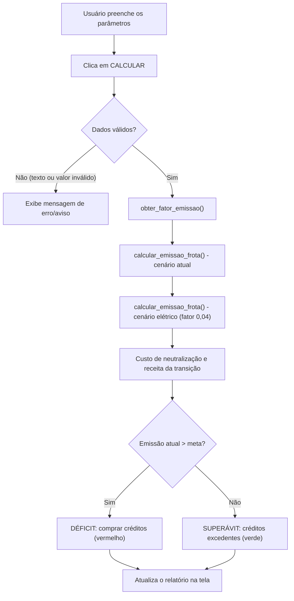

# 🌱 EcoFleet Analytics — Calculadora de Crédito de Carbono

### Tema: **Mobilidade Urbana Inteligente e Transição de Frotas**

Aplicação desktop em **Python + Tkinter** que simula as emissões de CO₂ de uma frota de veículos, o custo para compensar essas emissões no **mercado de carbono** e o ganho (ambiental e financeiro) obtido com a **transição da frota para veículos 100% elétricos**.

---

## 📌 Sumário

1. [Contexto do tema](#-contexto-do-tema)
2. [Funcionalidades](#-funcionalidades)
3. [Como executar](#-como-executar)
4. [Como usar a interface](#-como-usar-a-interface)
5. [Como o projeto funciona (arquitetura)](#-como-o-projeto-funciona-arquitetura)
6. [Explicação dos cálculos](#-explicação-dos-cálculos)
7. [Exemplo completo passo a passo](#-exemplo-completo-passo-a-passo)
8. [Limitações e simplificações](#-limitações-e-simplificações)

---

## 🌍 Contexto do tema

O setor de **transportes** é um dos maiores emissores de gases de efeito estufa (GEE) nas cidades. Frotas de logística, ônibus, aplicativos de entrega e veículos corporativos rodam milhares de quilômetros por ano queimando combustíveis fósseis.

A **Mobilidade Urbana Inteligente** propõe reduzir esse impacto por meio de:

- **Transição de frotas** — troca de veículos a diesel/gasolina por veículos elétricos ou movidos a biocombustíveis;
- **Gestão baseada em dados** — medir as emissões para saber onde e quanto reduzir;
- **Mecanismos de mercado** — uso de **créditos de carbono** para compensar emissões ou gerar receita com as reduções.

> 💡 **O que é um crédito de carbono?**
> Um crédito de carbono representa **1 tonelada de CO₂ equivalente (tCO₂e)** que deixou de ser emitida ou foi retirada da atmosfera. Empresas que emitem acima da sua meta precisam **comprar** créditos; empresas que emitem abaixo podem **vender** o excedente.

Este projeto ajuda um gestor de frota a responder três perguntas:

1. **Quanto a minha frota emite hoje?**
2. **Quanto custaria neutralizar essas emissões?**
3. **Quanto eu reduziria (e ganharia) se eletrificasse a frota?**

---

## ⚙️ Funcionalidades

- Seleção da matriz energética atual da frota (Diesel S10, Gasolina, Etanol ou Elétrico);
- Cálculo da **emissão anual** da frota em tCO₂e;
- Cálculo do **custo de neutralização total** (comprar créditos para 100% das emissões);
- Simulação do **cenário de transição para frota elétrica**;
- Cálculo da **redução de emissões** e da **receita potencial** com créditos de carbono;
- Comparação com a **meta/teto de emissões corporativa** (modelo *Cap and Trade*), indicando **déficit** (vermelho) ou **superávit** (verde);
- Validação de entradas e tratamento de erros (valores negativos, campos vazios, texto no lugar de número);
- Aceita vírgula ou ponto como separador decimal;
- Botão para restaurar valores padrão de teste.

---

## ▶️ Como executar

### Pré-requisitos

- **Python 3.8+**
- **Tkinter** (já vem incluído na instalação padrão do Python no Windows e macOS)

> No Linux, caso o Tkinter não esteja instalado: `sudo apt install python3-tk`

Não há dependências externas — o projeto usa apenas a biblioteca padrão.

### Execução

```bash
python calculadora_credito_carbono.py
```

---

## 🖥️ Como usar a interface

A janela é dividida em três áreas:

### 1. Parâmetros Operacionais da Frota Logística (entradas)

| Campo | Descrição | Unidade | Valor padrão |
|---|---|---|---|
| Matriz Energética Atual | Combustível usado hoje pela frota | — | Diesel S10 |
| Quantidade de Veículos | Número de veículos na frota | unidades | `15` |
| Distância Média por Veículo/Ano | Quilometragem anual de cada veículo | km | `60000` |
| Consumo Médio | Quanto combustível o veículo gasta por km | L/km | `0.32` |
| Teto / Meta Anual de Emissões | Limite de emissões definido pela empresa | tCO₂e | `500` |
| Cotação do Crédito de Carbono | Preço de 1 crédito no mercado | R$/tCO₂e | `75.00` |

> ⚠️ Atenção: o consumo é em **litros por km** (e não km por litro). Um caminhão que faz 3,125 km/L consome `1 / 3,125 = 0,32 L/km`.

### 2. Botões

- **CALCULAR EMISSÕES E IMPACTO FINANCEIRO** — executa a simulação;
- **RESTAURAR PADRÃO / LIMPAR** — volta os campos aos valores de exemplo e zera os resultados.

### 3. Relatório de Auditoria Ambiental e Mercado de Carbono (saídas)

| Indicador | O que significa |
|---|---|
| Emissão Bruta da Frota Atual | Total de tCO₂e emitido por ano com o combustível atual |
| Custo de Neutralização Total | Quanto custa comprar créditos para compensar 100% das emissões |
| Cenário de Transição (Frota Elétrica) | Emissão estimada caso a frota fosse 100% elétrica, e a redução obtida |
| Potencial de Receita com Créditos | Créditos gerados pela redução e o valor deles em R$ |
| Status da Meta Corporativa | Se a empresa ficou acima (déficit) ou abaixo (superávit) da meta |

---

## 🧩 Como o projeto funciona (arquitetura)

O código está em um único arquivo, [`calculadora_credito_carbono.py`](calculadora_credito_carbono.py), organizado em dois módulos lógicos:

### Módulo de Lógica e Cálculo (programação estruturada)

| Função | Responsabilidade |
|---|---|
| `obter_fator_emissao(matriz_energetica)` | Retorna o fator de emissão (kg CO₂ por litro) do combustível escolhido, por meio de uma estrutura condicional `if/elif/else` |
| `calcular_emissao_frota(qtd_veiculos, distancia_km, consumo_l_km, fator_emissao)` | Aplica a equação de inventário de fontes móveis e retorna as emissões totais em toneladas |
| `executar_calculo()` | Função principal do botão "Calcular": lê os dados, valida, executa os cálculos e atualiza os resultados na tela |
| `limpar_dados()` | Restaura os valores padrão e reinicia o painel de resultados |

### Módulo de Interface Gráfica (Tkinter / ttk)

Constrói a janela `760x680` com cabeçalho, formulário de entrada (`LabelFrame` + `grid`), botões de ação e painel de resultados com cores indicativas (vermelho = alerta, verde = sustentável).

### Fluxo de execução



---

## 🧮 Explicação dos cálculos

### 1. Fatores de emissão

O **fator de emissão (Fe)** indica quantos quilos de CO₂ são liberados ao queimar 1 litro de combustível. Os valores usados seguem como referência as diretrizes do **IPCC** e do **Programa Brasileiro GHG Protocol**:

| Matriz energética | Fator de emissão (Fe) | Observação |
|---|---|---|
| Óleo Diesel Comercial (S10) | **2,60** kg CO₂/L | Combustível fóssil mais comum em frotas pesadas |
| Gasolina Comum | **2,27** kg CO₂/L | Combustível fóssil de veículos leves |
| Etanol Hidratado / Biocombustível | **0,45** kg CO₂e/L | Baixo, pois o CO₂ é reabsorvido pela cana no plantio (emissão residual) |
| Veículo 100% Elétrico | **0,00** kg CO₂/L | Sem emissão direta no escapamento (Escopo 1 zero) |
| Cenário de transição elétrica | **0,04** kg CO₂e/unidade | Emissão indireta da geração de energia (Escopo 2), baixa devido à matriz elétrica brasileira (SIN) majoritariamente renovável |

> 📘 **Escopo 1 x Escopo 2 (GHG Protocol)**
> - **Escopo 1**: emissões **diretas**, que saem do escapamento do veículo.
> - **Escopo 2**: emissões **indiretas**, geradas pelas usinas que produzem a energia elétrica consumida.

---

### 2. Emissão da frota (equação de inventário móvel)

Primeiro calcula-se a emissão de **um veículo** em toneladas:

$$
E_{veículo} = \frac{D \times C \times F_e}{1000}
$$

Depois multiplica-se pelo número de veículos:

$$
E_{frota} = E_{veículo} \times N
$$

Onde:

| Símbolo | Significado | Unidade |
|---|---|---|
| `D` | Distância percorrida por veículo no ano | km |
| `C` | Consumo médio | L/km |
| `Fe` | Fator de emissão | kg CO₂/L |
| `N` | Quantidade de veículos | unidades |
| `÷ 1000` | Conversão de **kg** para **toneladas** | — |

**Por que funciona?** `D × C` dá o total de **litros** consumidos no ano; multiplicando por `Fe` obtemos os **kg de CO₂**; dividindo por 1000 chegamos a **toneladas**, que é a unidade dos créditos de carbono.

---

### 3. Cenário de transição para frota elétrica

A mesma equação é aplicada, mas com o fator residual de Escopo 2:

$$
E_{elétrica} = \frac{D \times C \times 0{,}04}{1000} \times N
$$

---

### 4. Custo de neutralização total

Para neutralizar 100% das emissões, a empresa precisaria comprar 1 crédito para cada tonelada emitida:

$$
Custo_{neutralização} = E_{frota} \times P_{crédito}
$$

Onde `P_crédito` é a cotação do crédito de carbono em R$/tCO₂e.

---

### 5. Redução de emissões e receita da transição

A redução é a diferença entre o cenário atual e o cenário elétrico. A função `max(0, ...)` garante que o resultado nunca seja negativo (por exemplo, quando a frota atual já é elétrica, com fator 0):

$$
Redução = \max(0,\; E_{frota} - E_{elétrica})
$$

Cada tonelada evitada equivale a 1 crédito de carbono, então a receita potencial é:

$$
Receita_{transição} = Redução \times P_{crédito}
$$

---

### 6. Balanço em relação à meta corporativa (*Cap and Trade*)

No modelo *Cap and Trade*, a empresa tem um **teto (cap)** de emissões. O balanço é:

$$
Balanço = Meta - E_{frota}
$$

| Resultado | Situação | Consequência |
|---|---|---|
| `Balanço < 0` | 🔴 **DÉFICIT AMBIENTAL** — emitiu acima da meta | Deve **comprar** `|Balanço|` créditos. Custo = `|Balanço| × P_crédito` |
| `Balanço ≥ 0` | 🟢 **SUPERÁVIT AMBIENTAL** — emitiu abaixo da meta | Gera `Balanço` créditos excedentes que podem ser **vendidos**. Lucro = `Balanço × P_crédito` |

---

## 📊 Exemplo completo passo a passo

Usando os **valores padrão** da aplicação:

| Parâmetro | Valor |
|---|---|
| Combustível | Diesel S10 (Fe = 2,60) |
| Veículos (N) | 15 |
| Distância (D) | 60.000 km/ano |
| Consumo (C) | 0,32 L/km |
| Meta | 500 tCO₂e |
| Cotação | R\$ 75,00 / tCO₂e |

**Passo 1 — Litros consumidos por veículo**
`60.000 km × 0,32 L/km = 19.200 L`

**Passo 2 — Emissão por veículo**
`19.200 L × 2,60 kg/L = 49.920 kg ÷ 1000 = 49,92 tCO₂e`

**Passo 3 — Emissão da frota**
`49,92 × 15 = 748,80 tCO₂e/ano`

**Passo 4 — Custo de neutralização total**
`748,80 × R$ 75,00 = R$ 56.160,00`

**Passo 5 — Cenário elétrico**
`(60.000 × 0,32 × 0,04) ÷ 1000 × 15 = 0,768 × 15 = 11,52 tCO₂e/ano`

**Passo 6 — Redução e receita da transição**
`748,80 − 11,52 = 737,28 tCO₂e` → **737,28 créditos**
`737,28 × R$ 75,00 = R$ 55.296,00`

**Passo 7 — Balanço com a meta**
`500 − 748,80 = −248,80` → 🔴 **DÉFICIT**
A empresa deve comprar **248,80 créditos** → `248,80 × R$ 75,00 = R$ 18.660,00`

### Resultado na tela

```
Emissão Bruta da Frota Atual:          748.80 tCO2e / ano
Custo de Neutralização Total (100%):   R$ 56,160.00 (para neutralizar 100%)
Cenário de Transição (Frota Elétrica): 11.52 tCO2e / ano (Redução de 737.28 tCO2e)
Potencial de Receita com Créditos:     737.28 Créditos | Receita: R$ 55,296.00
Status da Meta Corporativa:            DÉFICIT AMBIENTAL: Emitiu 248.80 tCO2e acima da meta.
                                       Compensação Obrigatória: Comprar 248.80 créditos (Custo: R$ 18,660.00).
```

### Comparação entre combustíveis (mesma frota)

| Combustível | Emissão da frota (tCO₂e/ano) | Situação vs. meta de 500 |
|---|---|---|
| Diesel S10 | 748,80 | 🔴 Déficit de 248,80 |
| Gasolina | 653,76 | 🔴 Déficit de 153,76 |
| Etanol | 129,60 | 🟢 Superávit de 370,40 |
| Elétrico (Escopo 1) | 0,00 | 🟢 Superávit de 500,00 |

👉 A conclusão é clara: **a transição da frota fóssil para etanol ou elétricos tira a empresa do déficit e transforma um custo ambiental em potencial receita.**

---

## ⚠️ Limitações e simplificações

Este é um projeto **educacional/simulador**. Alguns pontos importantes:

- **Unidade do cenário elétrico:** o fator residual de 0,04 é aplicado sobre o mesmo valor de consumo informado (L/km), como uma aproximação. Em um inventário real, o consumo de veículos elétricos é medido em **kWh/km** e o fator de Escopo 2 varia mês a mês conforme o fator de emissão do SIN publicado pelo MCTI.
- **Fatores de emissão fixos:** os valores são médias de referência; inventários oficiais usam fatores atualizados anualmente e consideram mistura obrigatória de biodiesel no diesel e de etanol anidro na gasolina.
- **Receita da transição:** representa o **valor econômico das emissões evitadas**. Para gerar créditos negociáveis de fato, um projeto precisa ser certificado (ex.: Verra, Gold Standard) e comprovar **adicionalidade**.
- **Validação do consumo:** o consumo aceita o valor `0`, enquanto os demais campos exigem valores maiores que zero.
- **Escopo 3** (fabricação dos veículos, baterias, ciclo de vida do combustível) não é considerado.

---

## 🛠️ Tecnologias

- **Python 3**
- **Tkinter / ttk** — interface gráfica
- **Programação estruturada** — funções modulares, estruturas condicionais e tratamento de exceções (`try/except ValueError`)

---

## 📚 Referências

- IPCC — *Guidelines for National Greenhouse Gas Inventories*
- Programa Brasileiro GHG Protocol — Ferramenta de cálculo de emissões
- MCTI — Fatores de emissão de CO₂ do Sistema Interligado Nacional (SIN)
